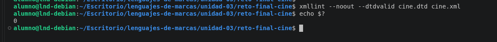
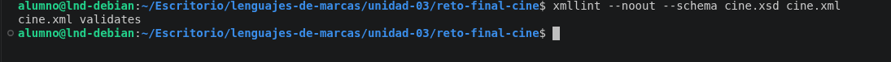
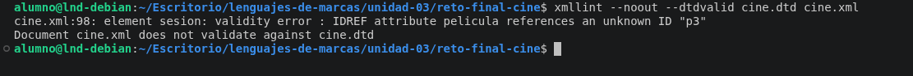
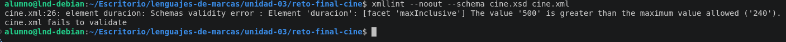

# Reto final de la unidad-03: Gestión de un cine

## Objetivo de la actividad

Se pondran en práctica los conocimientos adquiridos sobre **_XML, DTD, y XSD_**. Se diseñara un documento XML para gestionar la cartelera, las salas, las sesiones y las reservas de un cine, luego se creara un **DTD** y un **XSD** para definir y validar su estructura

---

## 1. Organización del proyecto

```
reto-final-cine/
│
├── cine.xml
├── cine.dtd
├── cine.xsd
├── README.md
│
└── capturas/
    ├── validacion-dtd.png
    ├── validacion-xsd.png
    ├── error-dtd.png
    └── error-xsd.png
```
- **cine.xml:** contiene los datos del cine.

- **cine.dtd:** define la estructura y los atributos permitidos.

- **cine.xsd:** establece la estructura y las restricciones de los datos

- **README.md:** contiene la explicación de este proyecto

- **capturas:** contiene las evidencias de las validaciones


---

## 3. Estructura del XML

Como elemento raíz `<cine>`.

Y dentro de ese elemento organize la información en diferentes bloques:

- **Información del cine:** contiene el nombre, la dirección, la localidad y el teléfono.

- **Cartelera:** contiene las cuatro películas, con sus títulos, directores, géneros, duración, fechas de estreno y otros atributos

- **Salas:** contiene las dos salas del cine y sus respectivas butacas

- **Seciones:** contiene las cuatro sesiones programadas, con sus fechas, horas y precios

- **Reservas:** contiene los datos de los clientes y las entradas reservadas

Ademas utilize identificadores únicos para relacionar diferentes elementos.

Por ejemplo, las sesiones hacen referencias a las peliculas y salas mediante sus identificadores. Las entradas a las butacas

---


## 4. Creación del DTD

El archivo cine.dtd sirve para definir la estructura que debe tener el documento XML.

- Los elementos que forman el documento.


- El orden de los elementos.


- Los elementos obligatorios y opcionales.


- Los elementos que pueden repetirse.
Los atributos obligatorios y opcionales.


- Los identificadores mediante ID.


- Las referencias mediante IDREF.


- Las enumeraciones para limitar los valores de determinados atributos.

---

## 5. Creación del XSD

El archivo cine.xsd perimite validar el documento **XML** mediante ***XML Schema***

Tambien utilice diferentes tipos de datos y restricciones para controlar que la información introducida sea correcta. 

Entre estas restricciones se encuentran:

-  Identificadores y referencias con xs:**ID** y xs:**IDREF**.

- Fechas mediante xs:date.


- Horas mediante xs:time.


- Precios mediante xs:decimal.


- Valores booleanos mediante xs:boolean.


- Restricciones para la duración de las películas, entre 30 y 240 minutos.


- Restricciones para la capacidad de las salas.


- Enumeraciones para clasificaciones, idiomas, estados y tipos de butacas.

Tambien utilice xs:sequence, xs:complexType, xs:simpleType, miOccurs y maxOccurs.

---

## 6. Validación del documento XML

Para comprobar que el documento XML cumple las reglas definidas he utilizado la herramiento **xmllint** desde la terminal del **Visual Studio Code** 

### 6.1 Validación correcta con DTD

Utilize el siguiente comando:

```
xmllint --noout --dtdvalid cine.dtd cine.xml

echo $?
```
El resultado ha sido **0**, lo que significa que el documento XML es válido respecto al DTD.




---

### 6.2 Validacion correcta del XSD

Utilice el siguiente comando:

```
xmllint --noout --schema cine.xsd cine.xml
```

El resultado ha sido **cine.xml validates**, indicando que el documento cumple las restricciones del XSD



---

## 7 Comprobación de errores

También he realizado pruebas modificando temporalmente el documento XML para comprobar que los validadores detectan los errores.

### 7.1 Error de validación con DTD

Provoque un error introduciendo una referencia a una película con identificador que no existe (p3).




---

### 7. 2 Error de validación con XSD

He cambiado temporalmente la duración de una película a 500 minutos, superando el máximo permitido a 240 minutos.

El XSD ha detectado que el valor introducido supera el límite establecido y ha indicado que el documento no es válido




---

> **OJO:** Despues de realizar las pruebas, he corregido los cambios temporales y he vuelto a validar el documento para asegurarme de que funciona correctamente con ambos esquema.

---

## 8. Diferencias entre DTD y XML

El DTD permite definir la estructura del documento XML, los elementos, los atributos, su orden y las referencias entre identificadores.

Por otro lado, el XSD permite realizar validaciones más completas, ya que puede controlar los tipos de datos y establecer restricciones sobre fechas, horas, números y valores.

El XSD es más completo y preciso que DTD porque permite controlar mejor los datos que se introducen en el documentos XML.

---
