<<<<<<< Updated upstream

# Actividad evaluable: Catálogo de libros actuales con XPath

## 1. Descripción del proyecto

En esta actividad he creado un catálogo XML de libros actuales para practicar el lenguaje XPath y aprender a consultar información almacenada en documentos XML.

El catálogo contiene 12 libros de diferentes géneros literarios:fantasía, thiller y misterio, ciencia ficción y romance.

He elegido estos géneros porque permiten trabajar con diferentes tipos de libros y realizar consultas variadas utilizando atributos, elementos, predicados, funciones y ejes de navegación XPath.

---

## 2. Géneros seleccionados

Los cuatro géneros pricipales del catálogo son:

- Fantatasía.

- Thiller y misterio.

- Ciencia ficción.

- Romance.

Además, algunos libros contienen otros géneros como **Juvenil, Drama, Misterio, Comedia, Ficción contemporánea y Distopía.**

---

## 3. Estructura del documento XML

El catálogo XML está organizado a partir de un elemento raíz `<biblioteca>`, 
que contiene los diferentes libros. Cada libro incluye información sobre 
su título, autor, año de publicación, géneros, editorial, formatos, precio 
y valoración. El elemento `<saga>` es opcional y solo aparece cuando el 
libro pertenece a una saga.

La estructura simplificada del documento es la siguiente:

```text
biblioteca
├── @actualizado
│
├── libro
│   ├── @id
│   ├── @disponible
│   ├── titulo
│   ├── autor
│   │   ├── nombre
│   │   └── nacionalidad
│   ├── añopublicacion
│   ├── generos
│   │   └── genero
│   ├── editorial
│   ├── formatos
│   │   └── formato
│   ├── precio
│   │   └── @moneda
│   ├── valoracion
│   ├── saga (opcional)
│   └── descripcion
│
├── libro
├── libro
├── ...
└── libro
```

---

## 4. Código XML completo y comprobación del XML

Antes de realizar las consultas XPath, se ha comprobado que el archivo 'biblioteca' está bien formado mediante el comando:

```bash
xmllint --noout biblioteca.xml
```
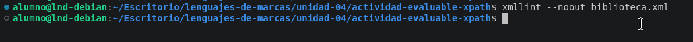

Se puede consultar el código completo del catálogo XML aquí:

[biblioteca.xml](biblioteca.xml)

---

## 5. Consultas XPath

En este apartado se documentarán las veinte consultas obligatorias, indicando su objetivo, expresión XPath, resultado obtenido e interpretación.

### Consulta-01 Elemento raíz `<biblioteca>`

```bash
xmllint --xpath '/biblioteca' biblioteca.xml
```
**Resultado**

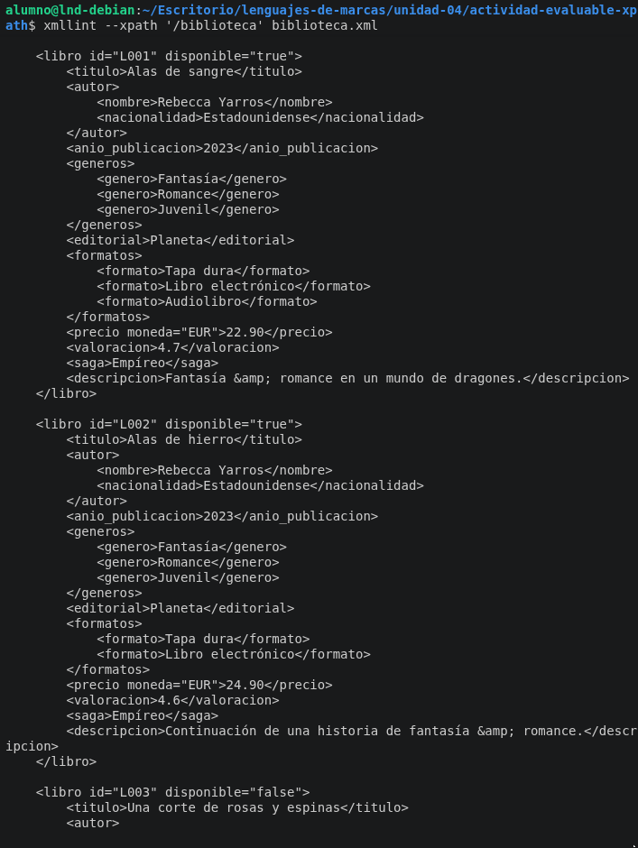

Selecciona el elemento Raíz


### Consulta-02 Todos los libros

```bash
xmllint --xpath '/biblioteca/libro' biblioteca.xml
```
**Resultado**

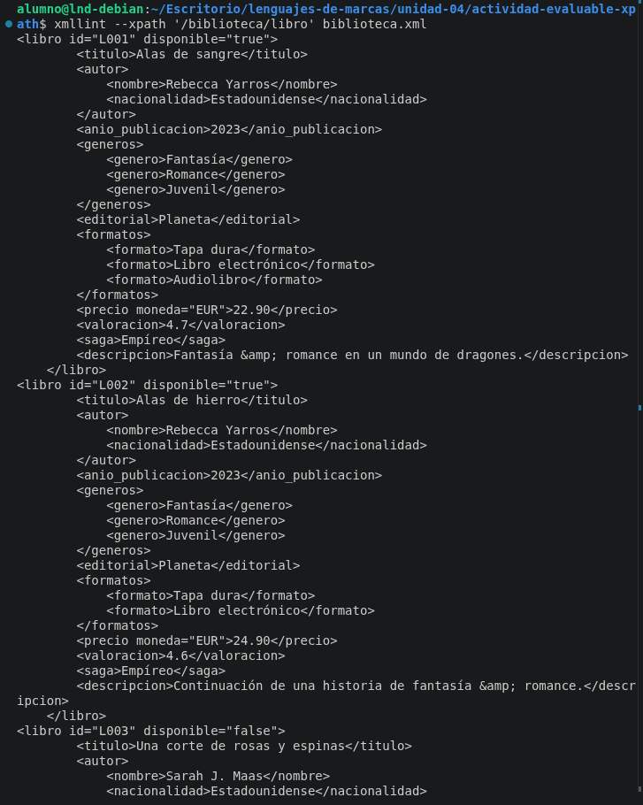

El resultado muestra todos los libros del xml

### Consulta-03 Todos los titulos

```bash
xmllint --xpath 'biblioteca/libro/titulo' biblioteca.xml
```
**Resultado**

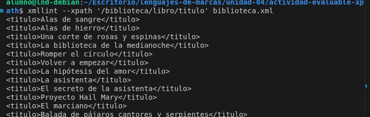
Muestra todos los titulos de los libros

### Consulta-04 Todos los Identificadores

```bash
xmllint --xpath '/biblioteca/libro/@id' biblioteca.xml
```

**Resultado**

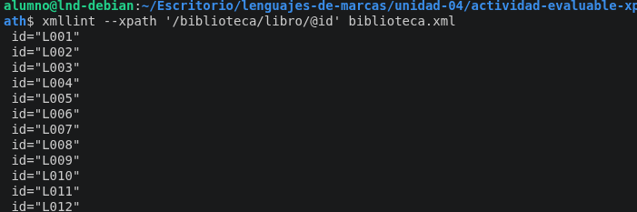

Muestra todos los `id`

### Consulta-05 Todos los géneros

```bash
xmllint --xpath '/biblioteca/libro/generos/genero' biblioteca.xml
```
**Resultado**

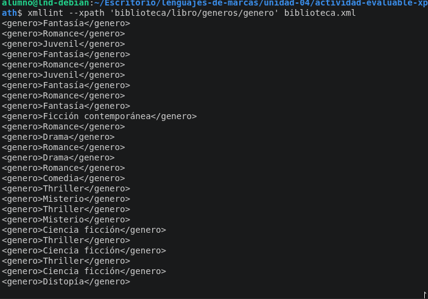

Muestra los generos de los libros 

### Consulta-06 Libro con un **ID** concreto

```bash
xmllint --xpath 'biblioteca/libro[@id="L005"]' biblioteca.xml
```

**Resultado**

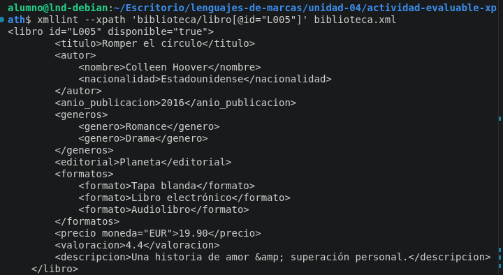

Muestra todo el `id` de `L005`

### Consulta-07 Titulos de libros disponibles

```bash
xmllint --xpaht '/biblioteca/libro/[@disponible="true"]/titulo' biblioteca.xml
```
**Resultado**

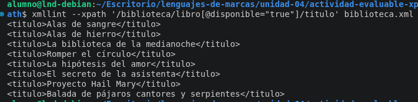

Muestra todos los libros disponibles

### Consulta-08 Libros de un género concreto

Por ejemplo. **Fantasía** 

```bash
xmllint --xpaht '/biblioteca/libro[generos/genero="Fantasia"]' biblioteca.xml
```
**Resultado**

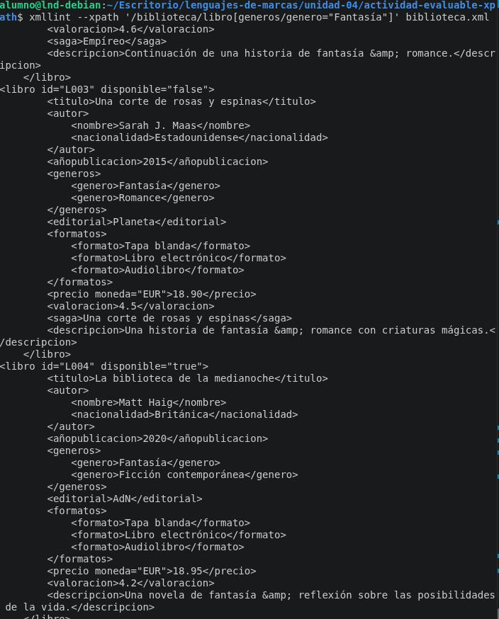

Muestra todos los libros del género **Fantasia**

### Consulta-09 Libros publicados desde 2020

```bash
xmllint --xpath '/biblioteca/libro/[añopublicacion >= 2020]' biblioteca.xml
```
**Resultado**

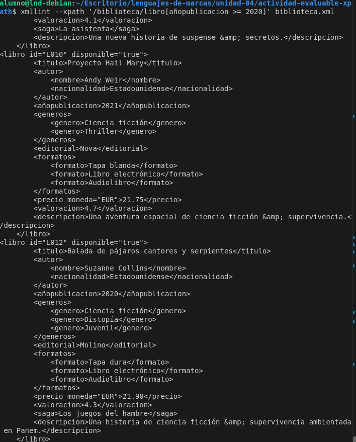

Muestra todos los libros publicados del 2020 en adelante 

### Consulta-10 Disponibles y con precio menor de 20 **€**

```bash
xmllint --xpath '/biblioteca/libro[@disponible="true" and precio < 20]' biblioteca.xml
```
**Resultado**

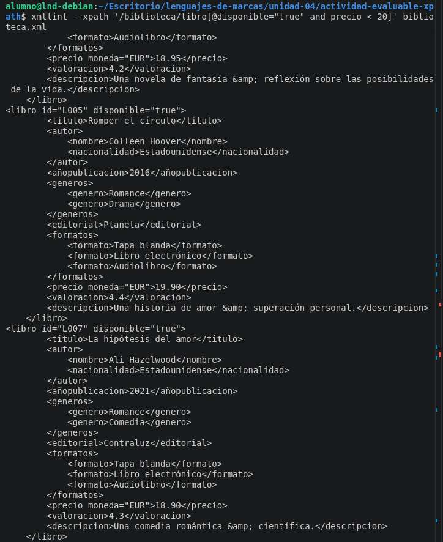

Muestra los precios disponibles menores a 20 €

### Consulta-11 Libros de Fantasía o Ciencia ficción

Aquí usamos `or`

```bash
xmllint --xpath '/biblioteca/libro[generos/genero="Fantasia" or generos/genero="Ciencia ficcion"]' biblioteca.xml
```
**Resultado**

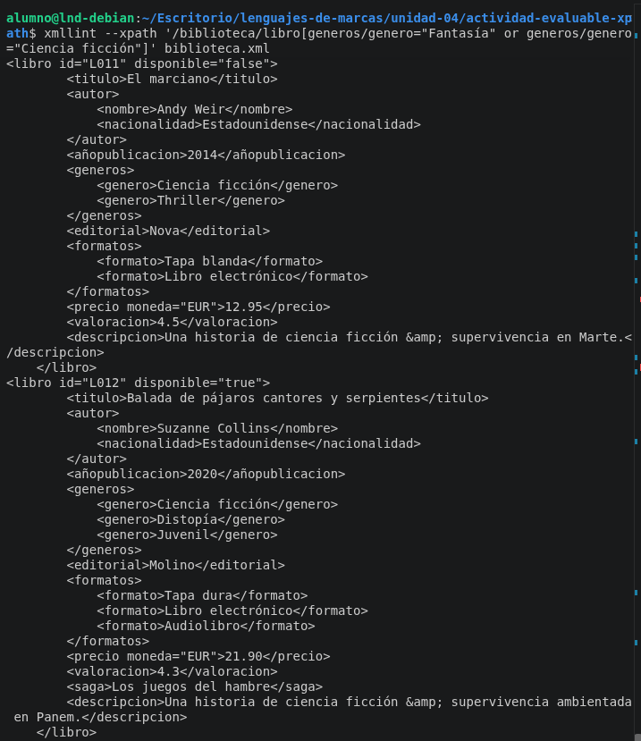


### Consulta-12 Libros que NO tienen `<saga>`

```bash
xmllint --xpath '/biblioteca/libro[not(saga)]' biblioteca.xml
```
**Resultado**

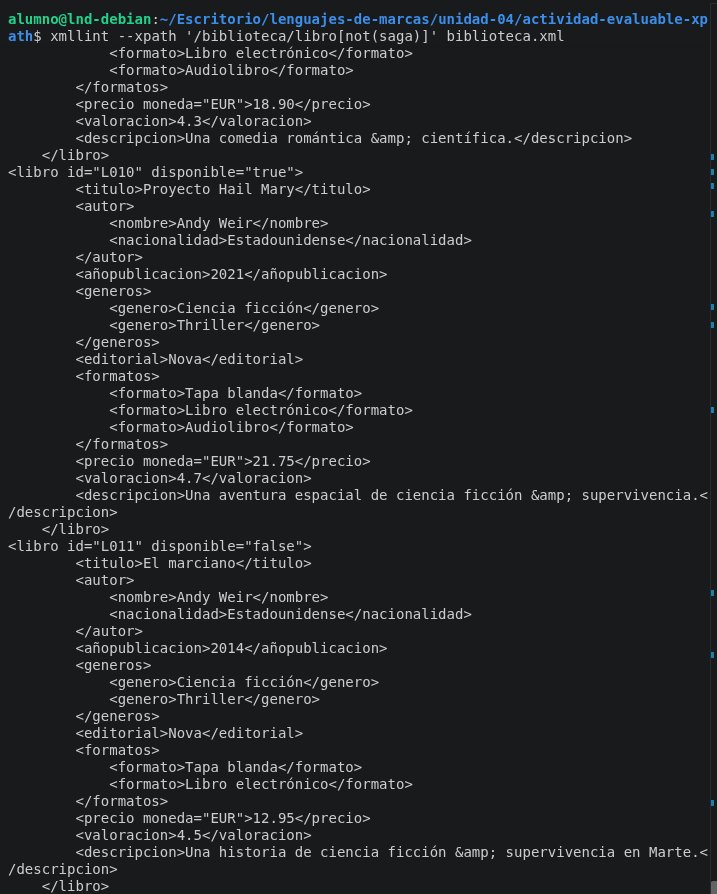

Muestra todos los libros que no tienen saga

### Consulta-13 Primer y ultimo libro

```bash
xmllint --xpath '(/biblioteca/libro)[1] | (/biblioteca/libro)[last()] biblioteca.xml'
```
**Resultado**

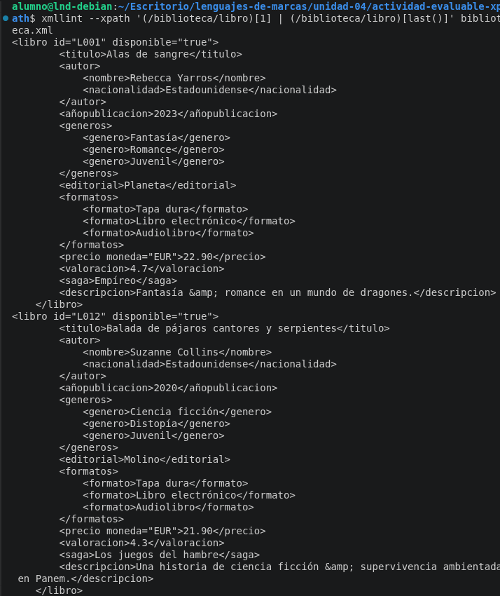

Muesta el primer y el ultimo libros del XML

### Consulta-14 Los tres primeros libros

```bash
xmllint --xpath 'biblioteca/libro[position() <= 3]' biblioteca.xml
```
**Resultado**

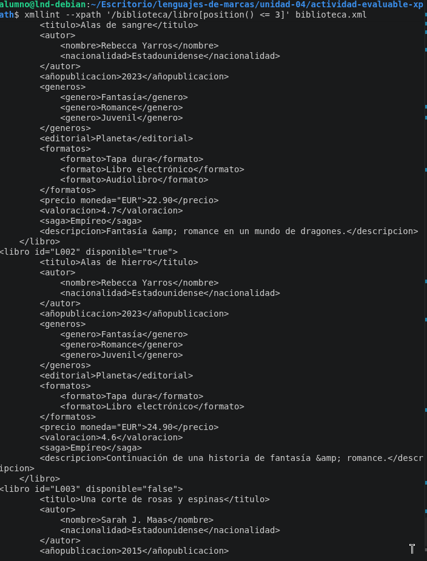

Muestra los tres primeros libros del XML

### Consulta-15 Numero Total de Libros

```bash
xmllint --xpath 'count(/biblioteca/libro)' biblioteca.xml
```
**Resultado**


Muestra el numero de todos los libros del XML

### Consulta-16 Numero de libros de Fantasia

```bash
xmllint --xpath 'count(/biblioteca/libro[generos/genero="Fantasia"]) biblioteca'
```
**Resultado**

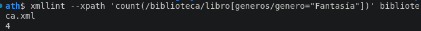

Muestra el numero de todos los libros de fantasia del XML

### Consulta-17 Títulos que contienen la palabra `asistenta`

```bash
xmllint --xpath '/biblioteca/libro[contains(titulo, "asistenta")]/titulo' biblioteca.xml
```
**Resultado**

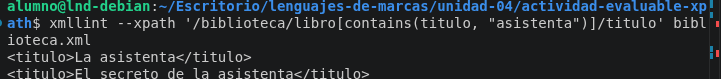

Muestra los libros que tienen esa palabra en especifico

### Consulta-18 Precio medio

Esta utiliza `sum()` y `count()`

```bash
xmllint --xpath 'sum(/biblioteca/libro/precio) div count(/biblioteca/libro/precio)' bilioteca.xml
```
**Resultado**

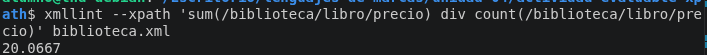


### Consulta-19 Usando `ancestor::libro`

Partimos de un `<genero>` y subimos hasta su `<libro>` para obtener el titulo

```bash
xmllint --xpath '//genero[.="Fantasia"]/ancestor::libro/titulo' biblioteca.xml
```
**Resultado**

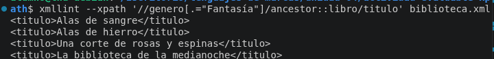

### Consulta-20 Usando `following-sibling`

Partimos de `<titulo>` y buscamos a su hermano `<autor>`:

```bash
xmllint --xpath '//titulo/following-sibling::autor/nombre' biblioteca.xml
```
**Resultado**

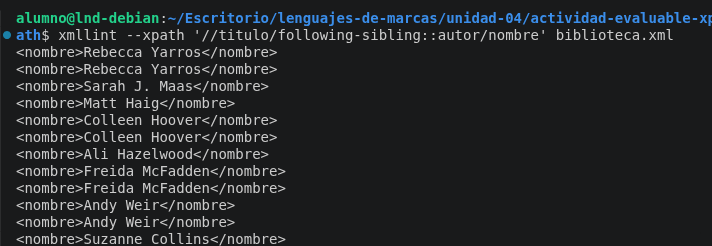
---

## 6. Problemas encontrados y soluciones aplicadas

Durante la realización de la actividad no se produjeron problemas importantes mas que ciertos errores de sintaxis en las consultas o en el xml al principio de su creación, solo corregi esos errores de sintaxis y dio los resultados esperados.

---


=======

# Actividad evaluable: Catálogo de libros actuales con XPath

## 1. Descripción del proyecto

En esta actividad he creado un catálogo XML de libros actuales para practicar el lenguaje XPath y aprender a consultar información almacenada en documentos XML.

El catálogo contiene 12 libros de diferentes géneros literarios:fantasía, thiller y misterio, ciencia ficción y romance.

He elegido estos géneros porque permiten trabajar con diferentes tipos de libros y realizar consultas variadas utilizando atributos, elementos, predicados, funciones y ejes de navegación XPath.

---

## 2. Géneros seleccionados

Los cuatro géneros pricipales del catálogo son:

- Fantatasía.

- Thiller y misterio.

- Ciencia ficción.

- Romance.

Además, algunos libros contienen otros géneros como **Juvenil, Drama, Misterio, Comedia, Ficción contemporánea y Distopía.**

---

## 3. Estructura del documento XML

El catálogo XML está organizado a partir de un elemento raíz `<biblioteca>`, 
que contiene los diferentes libros. Cada libro incluye información sobre 
su título, autor, año de publicación, géneros, editorial, formatos, precio 
y valoración. El elemento `<saga>` es opcional y solo aparece cuando el 
libro pertenece a una saga.

La estructura simplificada del documento es la siguiente:

```text
biblioteca
├── @actualizado
│
├── libro
│   ├── @id
│   ├── @disponible
│   ├── titulo
│   ├── autor
│   │   ├── nombre
│   │   └── nacionalidad
│   ├── añopublicacion
│   ├── generos
│   │   └── genero
│   ├── editorial
│   ├── formatos
│   │   └── formato
│   ├── precio
│   │   └── @moneda
│   ├── valoracion
│   ├── saga (opcional)
│   └── descripcion
│
├── libro
├── libro
├── ...
└── libro
```

---

## 4. Código XML completo y comprobación del XML

Antes de realizar las consultas XPath, se ha comprobado que el archivo 'biblioteca' está bien formado mediante el comando:

```bash
xmllint --noout biblioteca.xml
```


Se puede consultar el código completo del catálogo XML aquí:

[biblioteca.xml](biblioteca.xml)

---

## 5. Consultas XPath

En este apartado se documentarán las veinte consultas obligatorias, indicando su objetivo, expresión XPath, resultado obtenido e interpretación.

### Consulta-01 Elemento raíz `<biblioteca>`

```bash
xmllint --xpath '/biblioteca' biblioteca.xml
```
**Resultado**


Selecciona el elemento Raíz


### Consulta-02 Todos los libros

```bash
xmllint --xpath '/biblioteca/libro' biblioteca.xml
```
**Resultado**


El resultado muestra todos los libros del xml

### Consulta-03 Todos los titulos

```bash
xmllint --xpath 'biblioteca/libro/titulo' biblioteca.xml
```
**Resultado**


Muestra todos los titulos de los libros

### Consulta-04 Todos los Identificadores

```bash
xmllint --xpath '/biblioteca/libro/@id' biblioteca.xml
```

**Resultado**


Muestra todos los `id`

### Consulta-05 Todos los géneros

```bash
xmllint --xpath '/biblioteca/libro/generos/genero' biblioteca.xml
```
**Resultado**


Muestra los generos de los libros 

### Consulta-06 Libro con un **ID** concreto

```bash
xmllint --xpath 'biblioteca/libro[@id="L005"]' biblioteca.xml
```

**Resultado**


Muestra todo el `id` de `L005`

### Consulta-07 Titulos de libros disponibles

```bash
xmllint --xpaht '/biblioteca/libro/[@disponible="true"]/titulo' biblioteca.xml
```
**Resultado**


Muestra todos los libros disponibles

### Consulta-08 Libros de un género concreto

Por ejemplo. **Fantasía** 

```bash
xmllint --xpaht '/biblioteca/libro[generos/genero="Fantasia"]' biblioteca.xml
```
**Resultado**


Muestra todos los libros del género **Fantasia**

### Consulta-09 Libros publicados desde 2020

```bash
xmllint --xpath '/biblioteca/libro/[añopublicacion >= 2020]' biblioteca.xml
```
**Resultado**


Muestra todos los libros publicados del 2020 en adelante 

### Consulta-10 Disponibles y con precio menor de 20 **€**

```bash
xmllint --xpath '/biblioteca/libro[@disponible="true" and precio < 20]' biblioteca.xml
```
**Resultado**


Muestra los precios disponibles menores a 20 €

### Consulta-11 Libros de Fantasía o Ciencia ficción

Aquí usamos `or`

```bash
xmllint --xpath '/biblioteca/libro[generos/genero="Fantasia" or generos/genero="Ciencia ficcion"]' biblioteca.xml
```
**Resultado**


### Consulta-12 Libros que NO tienen `<saga>`

```bash
xmllint --xpath '/biblioteca/libro[not(saga)]' biblioteca.xml
```
**Resultado**


Muestra todos los libros que no tienen saga

### Consulta-13 Primer y ultimo libro

```bash
xmllint --xpath '(/biblioteca/libro)[1] | (/biblioteca/libro)[last()] biblioteca.xml'
```
**Resultado**


Muesta el primer y el ultimo libros del XML

### Consulta-14 Los tres primeros libros

```bash
xmllint --xpath 'biblioteca/libro[position() <= 3]' biblioteca.xml
```
**Resultado**


Muestra los tres primeros libros del XML

### Consulta-15 Numero Total de Libros

```bash
xmllint --xpath 'count(/biblioteca/libro)' biblioteca.xml
```
**Resultado**


Muestra el numero de todos los libros del XML

### Consulta-16 Numero de libros de Fantasia

```bash
xmllint --xpath 'count(/biblioteca/libro[generos/genero="Fantasia"]) biblioteca'
```
**Resultado**


Muestra el numero de todos los libros de fantasia del XML

### Consulta-17 Títulos que contienen la palabra `asistenta`

```bash
xmllint --xpath '/biblioteca/libro[contains(titulo, "asistenta")]/titulo' biblioteca.xml
```
**Resultado**


Muestra los libros que tienen esa palabra en especifico

### Consulta-18 Precio medio

Esta utiliza `sum()` y `count()`

```bash
xmllint --xpath 'sum(/biblioteca/libro/precio) div count(/biblioteca/libro/precio)' bilioteca.xml
```
**Resultado**


### Consulta-19 Usando `ancestor::libro`

Partimos de un `<genero>` y subimos hasta su `<libro>` para obtener el titulo

```bash
xmllint --xpath '//genero[.="Fantasia"]/ancestor::libro/titulo' biblioteca.xml
```
**Resultado**


### Consulta-20 Usando `following-sibling`

Partimos de `<titulo>` y buscamos a su hermano `<autor>`:

```bash
xmllint --xpath '//titulo/following-sibling::autor/nombre' biblioteca.xml
```
**Resultado**

---

## 6. Problemas encontrados y soluciones aplicadas

Durante la realización de la actividad no se produjeron problemas importantes mas que ciertos errores de sintaxis en las consultas o en el xml al principio de su creación, solo corregi esos errores de sintaxis y dio los resultados esperados.

---


>>>>>>> Stashed changes
